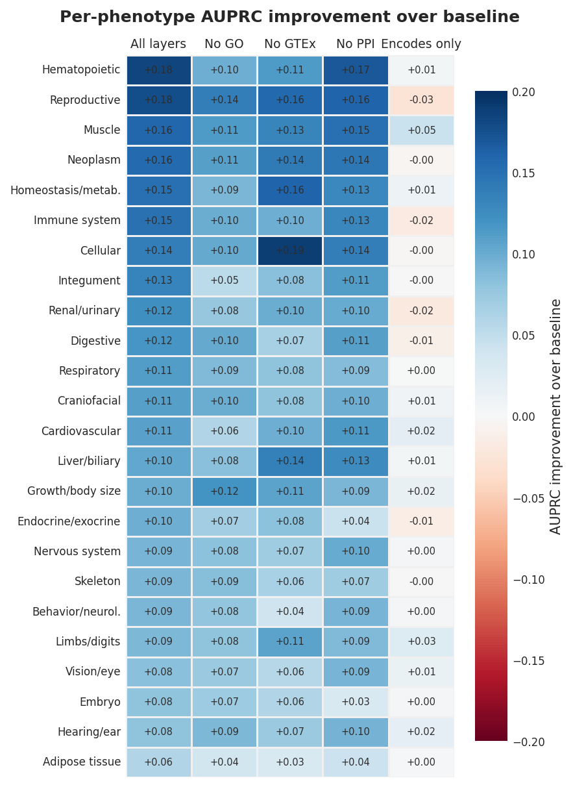
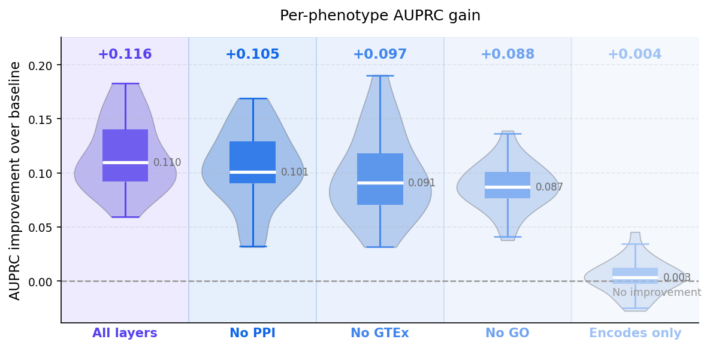
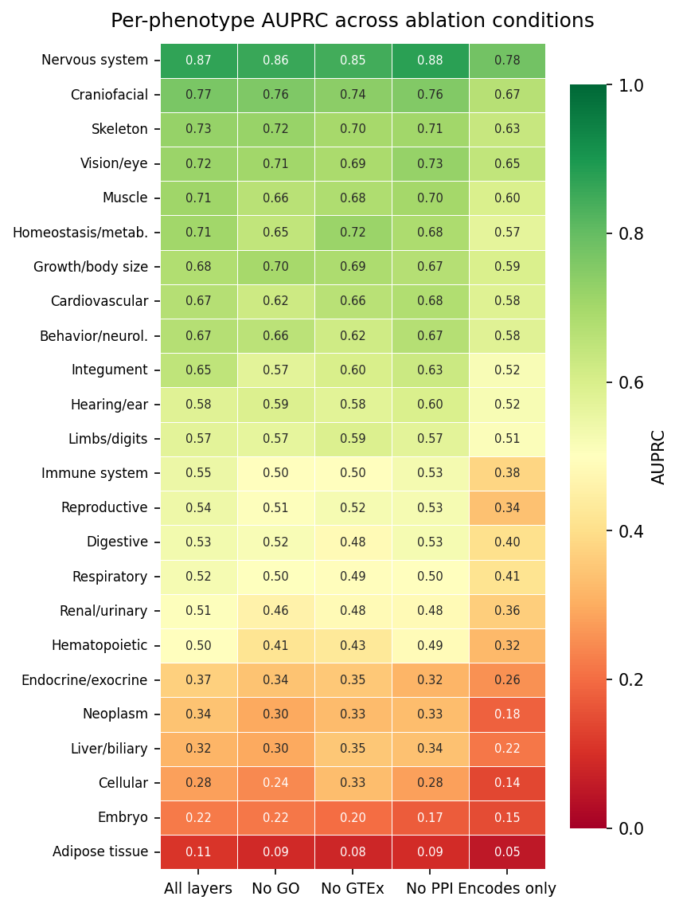

# Disentangling molecular predictors of genotype-to-phenotype relationships

This repository builds heterogeneous human and mouse knowledge graphs for
gene-to-phenotype prediction, then evaluates which molecular evidence layers
help recover Mammalian Phenotype (MP) associations.

The motivating biological question is whether gene neighbourhood information
from Gene Ontology annotations, expression atlases, protein-protein
interactions, and anatomy mappings can improve phenotype prediction beyond the
observed phenotype-label prevalence. The project compares two modelling
tracks:

| Track | Framework | Entry point | Prediction task |
|---|---|---|---|
| Knowledge graph embeddings | PyKEEN, RotatE | `run_kge.py` | Score missing gene-phenotype triples |
| Graph neural network classification | PyTorch, R-GCN, logistic regression | `run_rgcn.py` | Predict MP top-level classes from gene embeddings |

Graph construction uses BioCypher. Dependency management uses `uv`
exclusively.

## Goals and Objectives

The aim of this work is to investigate similarities and dissimilarities in the
determinants of gene-phenotype relations in humans and mice.

Specific objectives:

1. Construct a heterogeneous knowledge graph for human and mouse genes
   integrating protein-protein interactions (BioGRID), tissue-wide gene
   expression (GTEx / MGI GXD), and Gene Ontology annotations.
2. Train a leakage-free R-GCN encoder to predict associations between genes
   and top-level Mammalian Phenotype (MP) terms, using gene-phenotype edges
   as classification targets only.
3. Quantify the independent contribution of each biological data layer via a
   systematic ablation study (full graph vs. leave-one-layer-out conditions).
4. Compare layer contributions between the human and mouse models to identify
   species-specific predictive signals.

## Installation

System requirements:

- Linux or macOS (Windows has not been tested).
- Python 3.11 or newer.
- `uv` for dependency management.

Set up the repository:

```bash
git clone <repo>
cd <repo>
uv sync
```

Download raw data into `data/raw/`:

```bash
uv run python scripts/download_data.py
```

The script fetches all required files from the Zenodo record
[10.5281/zenodo.20379520](https://doi.org/10.5281/zenodo.20379520) and saves
them to `data/raw/`. Files that already exist are skipped. Large raw and
processed data live under `data/`, which is gitignored.

Alternatively, each file can be downloaded directly from its original source:

| File | Source |
|---|---|
| `hp.obo` | [Human Phenotype Ontology](https://hpo.jax.org/) |
| `genes_to_phenotype.txt` | [Human Phenotype Ontology](https://hpo.jax.org/) |
| `HP2MP.tsv` | [Mouse Genome Informatics](https://www.informatics.jax.org/) |
| `mp.obo` | [Mammalian Phenotype Ontology](https://www.informatics.jax.org/vocab/mp_ontology/) |
| `MGI_PhenoGenoMP.rpt` | [Mouse Genome Database](https://www.informatics.jax.org/) |
| `gxdrnaseq.tar.gz`, `gxd_uberon_mapping.tsv` | [MGI Gene Expression Database](https://www.informatics.jax.org/downloads/reports/gxdrnaseq/gxdrnaseq.tar.gz) |
| `gene2go.gz`,  | [NCBI Gene FTP](https://ftp.ncbi.nlm.nih.gov/gene/DATA/gene2go.gz) |
| `gene_info.gz` | [NCBI Gene FTP](https://ftp.ncbi.nlm.nih.gov/gene/DATA/gene_info.gz) |
| `GTEx_Analysis_v10_RNASeQCv2.4.2_gene_median_tpm.gct.gz` | [GTEx Portal](https://gtexportal.org/) |
| `BIOGRID-ALL-5.0.256.tab3.txt` | [BioGRID](https://downloads.thebiogrid.org/File/BioGRID/Release-Archive/BIOGRID-5.0.256/BIOGRID-ALL-5.0.256.tab3.zip) |
| `basic.obo` | [Uberon anatomy ontology](https://obophenotype.github.io/uberon/) |

## Usage

Build BioCypher graphs:

```bash
uv run python run_kg.py 
```

Use `--species` to select the source files and schema. `--species both` builds
human and mouse graphs with the same timestamp, which is useful before
cross-species comparisons.

Run KGE ablations:

```bash
uv run python run_kge.py --species human --config configs/machine_learning/kge_human.yaml

uv run python run_kge.py --species mouse --config configs/machine_learning/kge_mouse.yaml
```

KGE uses RotatE by default. The full config uses seed 42, 128-dimensional
embeddings, 64 negatives per positive, and an 80,000 target-step budget so
conditions receive comparable optimization effort. `--fast` is only a smoke
test preset with reduced epochs and dimensionality.

Run R-GCN ablations:

```bash
uv run python run_rgcn.py --species human --config configs/machine_learning/rgcn_human.yaml

uv run python run_rgcn.py --species mouse --config configs/machine_learning/rgcn_mouse.yaml
```

R-GCN uses phenotype edges only as labels. They are never included in the
encoder message-passing graph. The default config uses seed 42, 128-dimensional
embeddings, 500 encoder epochs, five negatives per positive edge, and a fixed
80/20 gene-level split reused across ablation conditions.

## Input and Output Examples

Raw inputs are expected in `data/raw/`. The downloader fetches:

- `hp.obo` and `mp.obo`
- `genes_to_phenotype.txt`
- `HP2MP.tsv`
- `MGI_PhenoGenoMP.rpt`
- `gene2go.gz` and `gene_info.gz`
- `GTEx_Analysis_v10_RNASeQCv2.4.2_gene_median_tpm.gct.gz`
- `gxdrnaseq.tar.gz` and `gxd_uberon_mapping.tsv`
- `BIOGRID-ALL-5.0.256.tab3.txt`
- `basic.obo`

Example human HPO input:

```text
ncbi_gene_id	gene_symbol	hpo_id	hpo_name	frequency	disease_id
10	NAT2	HP:0000007	Autosomal recessive inheritance	-	OMIM:243400
10	NAT2	HP:0001939	Abnormality of metabolism/homeostasis	-	OMIM:243400
```

Example processed human phenotype edge:

```text
gene_id	gene_symbol	mp_top_id	source_hp_ids	min_hp_to_anchor_dist
HGNC:A2ML1	A2ML1	MP:0005377	HP:0000403	5
HGNC:A2ML1	A2ML1	MP:0005387	HP:0000403	4
```

Example processed GO edge:

```text
gene_id	gene_symbol	go_id	go_name	evidence_code	aspect
HGNC:NAT2	NAT2	GO:0004060	arylamine N-acetyltransferase activity	IBA	F
HGNC:NAT2	NAT2	GO:0005515	protein binding	IPI	F
```

Example R-GCN per-phenotype output:

```text
mp_term_id,ap,n_pos_test,n_test,baseline
MP:0003631,0.8764,812,1049,0.7741
MP:0005382,0.7576,691,1049,0.6587
```

Primary generated outputs:

- `data/processed/<species>/`: normalized TSV nodes and edges.
- `data/biocypher/<species>_<timestamp>/`: BioCypher CSVs for Neo4j import.
- `results/ml/<species>/rgcn/<condition>/`: R-GCN checkpoints, logs, and AUPRC
  tables.
- `results/ml/<species>/kge/<model>/<condition>/`: PyKEEN checkpoints,
  metrics, and prediction artifacts.

## Results

### Overall performance

The full R-GCN pipeline achieved a macro-averaged AUPRC of **0.55** across 24
MP top-level phenotype classes on the human test set (mean improvement over
random baseline: **+0.116**). On the mouse test set the mean baseline
improvement was **+0.171** across 28 phenotype classes. The `encodes_only`
condition (gene-protein edges only) yielded near-zero improvement for both human
(+0.004) and mouse (+0.040), confirming that functional context — rather than
gene identity alone — drives predictive signals.

### Ablation: human graph

Removal of GO annotations caused the largest mean performance drop (−0.028),
followed by GTEx expression (−0.019) and PPI (−0.011), indicating that GO
provides the strongest predictive signal among the tested context layers.





### Ablation: mouse graph

GO removal had the strongest negative effect, with a much larger mean drop than
in the human graph (−0.106). PPI removal had almost no effect (+0.001), and
removing the expression layer slightly improved performance (+0.011), suggesting
that MGI GXD RNA-seq introduces noise rather than a useful signal in the current
mouse graph.


### Per-phenotype heterogeneity

Top-performing human phenotype classes (Nervous system 0.87, Craniofacial 0.77,
Skeleton 0.73) consistently maintained high AUPRC across all ablation conditions.
Lower-performing classes (Adipose tissue 0.11, Embryo 0.22, Cellular 0.28)
showed greater sensitivity to layer removal. In the human graph, removing GTEx
expression improved performance for Cellular (+0.19 vs +0.14) and Growth/body
size phenotypes. In the mouse graph, the No Expression condition outperformed
All layers for Nervous system (+0.31 vs +0.28) and Digestive (+0.22 vs +0.17).



## Conclusions

- **Functional annotations (GO) are the dominant predictor** of gene-phenotype
  associations in both species. GO removal causes the largest performance drop in
  human (−0.028) and by far the largest in mouse (−0.106).
- **Expression layer contributions diverge between species.** GTEx tissue-level
  expression provides a consistent, moderate gain in the human model, whereas
  MGI GXD RNA-seq marginally harms mouse model performance on average. This
  likely reflects the broader and more uniform sampling of GTEx compared with the
  heterogeneous developmental and conditional experiments in MGI GXD.
- **PPI provides complementary but modest gains.** Protein interaction edges
  contribute consistently in the human model but contribute almost nothing in the
  mouse model, where GO annotations may already capture sufficient functional
  context.
- **Gene identity alone is insufficient.** The `encodes_only` baseline (near-zero
  improvement) shows that neighbourhood aggregation over biological context edges
  is essential for phenotype prediction.
- **Per-phenotype heterogeneity is substantial.** A uniform-architecture model
  cannot be simultaneously optimal for all phenotype classes, motivating future
  work on attention-based GNN architectures with adaptive per-relation-type
  weights and phenotype-stratified model selection.

## Repository Layout

```text
phenotype_prediction_project/
├── run_kg.py                          # entry point: build BioCypher KG
├── run_kge.py                         # entry point: train & evaluate KGE (RotatE)
├── run_rgcn.py                        # entry point: train & evaluate R-GCN + logistic regression
│
├── configs/
│   ├── knowledge_graph/
│   │   ├── biocypher_config.yaml      # BioCypher driver settings
│   │   ├── schema_config_human.yaml   # node/edge types for the human graph
│   │   └── schema_config_mouse.yaml   # node/edge types for the mouse graph
│   └── machine_learning/
│       ├── kge_human.yaml             # RotatE hyperparameters for human
│       ├── kge_mouse.yaml             # RotatE hyperparameters for mouse
│       ├── rgcn_human.yaml            # R-GCN hyperparameters for human
│       └── rgcn_mouse.yaml            # R-GCN hyperparameters for mouse
│
├── src/
│   ├── knowledge_graph/
│   │   ├── adapters/                  # BioCypher adapters
│   │   ├── layers/                    # per-layer TSV export logic
│   │   ├── preprocessing/             # HP→MP mapping, ontology traversal
│   │   ├── build_graph.py             # orchestrates adapter calls into BioCypher
│   │   └── gene_ids.py                # HGNC / MGI gene identifier resolution
│   ├── machine_learning/
│   │   ├── common/                    # data loading, splits, metrics, leakage guard
│   │   ├── kge/                       # PyKEEN training, ablation, evaluation
│   │   └── rgcn/                      # R-GCN model, embeddings, classifier, ablation
│   └── utils/
│       ├── gene_info.py               # NCBI gene_info helpers
│       └── logging_config.py          # shared logging setup
│
├── scripts/
│   ├── download_data.py               # downloads all raw files from Zenodo
│   └── mouse/
│       └── make_uberon_mapping.py     # generates gxd_uberon_mapping.tsv
│
├── data/                              # gitignored
│   ├── raw/                           # files downloaded by scripts/download_data.py
│   ├── processed/
│   │   ├── human/                     # normalized node_*.tsv and edge_*.tsv tables
│   │   └── mouse/                     # same for mouse
│   ├── biocypher/
│   │   └── {species}_{timestamp}/     # BioCypher CSV exports for Neo4j import
│   └── external/
│       └── mp_labels.csv              # MP top-level term display names
│
└── results/                           # gitignored
    └── ml/
        ├── human/
        │   ├── rgcn/
        │   │   └── {condition}/       # model checkpoint, per-phenotype AUPRC TSV, logs
        │   └── kge/
        │       └── {model}/{condition}/  # PyKEEN checkpoint, MRR/Hits@K, AUPRC TSV
        └── mouse/
            └── rgcn/
                └── {condition}/
```

## Evaluation Contract

- `HumanGeneHasMpTopTerm` and `MouseGeneHasMpTopTerm` edges are labels, not
  message-passing context, in the R-GCN track.
- The `MultiLabelBinarizer` is fitted once before ablations, and the seed-42
  80/20 gene split is reused unchanged across conditions.
- Genes absent from an ablation graph receive zero embeddings instead of being
  silently dropped.
- Parallel R-GCN runs use spawn-based subprocesses.
- KGE evaluation intentionally uses `filter_known=True`.

## Limitations

- Missing gene-phenotype links are not true negatives.
- Human and mouse phenotype annotations come from different experimental and curation regimes.
- HP-to-MP mapping quality affects cross-species comparability.
- MP top-level classes are broad phenotype-system labels, not fine-grained phenotypes.
- High predictive performance does not by itself imply biological mechanism.

## References

- HGNC: HUGO Gene Nomenclature Committee, https://www.genenames.org/
- GTEx Portal, https://gtexportal.org/
- BioGRID, https://thebiogrid.org/
- Gene Ontology, https://geneontology.org/
- Uberon anatomy ontology, https://obophenotype.github.io/uberon/
- MGI and Mouse Genome Database, https://www.informatics.jax.org/
- Mammalian Phenotype Ontology, https://www.informatics.jax.org/vocab/mp_ontology/
- Human Phenotype Ontology, https://hpo.jax.org/
- BioCypher, https://biocypher.org/
- PyKEEN, https://pykeen.readthedocs.io/
- RotatE: Sun et al., 2019.
- R-GCN: Schlichtkrull et al., 2018.
